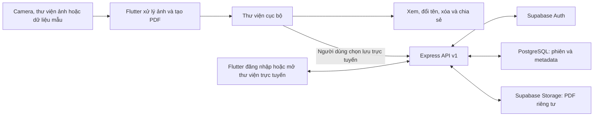

# Báo cáo kỹ thuật dự án ScanPDF

- **Ngày đối chiếu** 12/11/2026
- **Mã nguồn chính** `ScanPDF-Source/`
- **Phạm vi** Cấu trúc workspace, chức năng, luồng xử lý, mô hình dữ liệu, API, bảo mật, cách chạy và kiểm thử.

## 1. Tổng quan

ScanPDF là ứng dụng Flutter để chụp hoặc nhập ảnh giấy tờ, chỉnh từng trang, tạo PDF dạng ảnh và quản lý tài liệu trên thiết bị. Trên Android, người dùng có thể cấu hình API để đăng ký tài khoản bằng email, lưu một bản PDF trực tuyến theo yêu cầu và mở lại tài liệu từ thư viện riêng. Luồng quét và tạo PDF thực hiện trong ứng dụng. API nhận PDF đã xuất.

| Thành phần | Vai trò |
| --- | --- |
| Flutter và Dart | Giao diện Material tiếng Việt, camera, xử lý ảnh, tạo PDF, lưu trên máy, chia sẻ và gọi HTTP. `pubspec.yaml` khai báo phiên bản ứng dụng `1.0.1+2`, Dart `^3.9.2`. |
| Android và Kotlin | Cấu hình ứng dụng, quyền hệ thống và cầu nối `MethodChannel` để xem PDF tải về bằng `PdfRenderer`. |
| Node.js và Express | Xác thực request, phân quyền, kiểm tra PDF, điều phối giao dịch giữa metadata và kho tệp. Dự án yêu cầu Node.js từ 24. |
| Supabase | Auth quản lý tài khoản và phiên. PostgreSQL giữ metadata. Storage lưu bytes PDF trong bucket riêng. |
| Flutter Web | Bản dùng thử với tài liệu mẫu và thư viện cục bộ. Tính năng tài khoản trực tuyến chỉ được bật cho Android có cấu hình API. |



## 2. Cấu trúc thư mục

Cây dưới đây hiển thị mã nguồn, tài liệu và thư mục làm việc chính. Các tệp sinh tự động, thư viện đã cài và tài nguyên ảnh được gộp theo thư mục.

```text
E:/ScanPdf/
├── ScanPDF-Source/                        # Bản tích hợp frontend, backend và Supabase
│   ├── README.md                          # Cách cấu hình, chạy và kiểm thử bản tích hợp
│   ├── BAO-CAO-TOI-UU-CACHE.md             # Báo cáo riêng về tối ưu ảnh bìa
│   ├── .gitignore
│   ├── frontend/
│   │   ├── lib/
│   │   │   ├── main.dart                  # Điểm vào và chọn màn hình theo phiên
│   │   │   ├── common.dart                # Chủ đề, widget và thao tác UI dùng chung
│   │   │   ├── account.dart               # Đăng ký, đăng nhập, hồ sơ, biểu mẫu mật khẩu
│   │   │   ├── account_options.dart       # Dung lượng, tùy chọn quét, trợ giúp, quyền riêng tư
│   │   │   ├── camera_screen.dart         # Quyền camera, chụp ảnh, đèn, vòng đời camera
│   │   │   ├── editor.dart                # Nguồn ảnh, quản lý trang, cắt, chỉnh và xuất
│   │   │   ├── scan_data.dart             # Kiểu dữ liệu, xử lý ảnh, tạo PDF, lưu cục bộ
│   │   │   ├── library.dart               # Thư viện, ảnh bìa, trình xem, chia sẻ
│   │   │   ├── design_preview.dart        # Giao diện minh họa upload và OCR
│   │   │   ├── stitch_gallery.dart        # Đối chiếu 19 khung giao diện Stitch
│   │   │   └── online/
│   │   │       ├── api_client.dart        # HTTP, timeout, giới hạn byte và lỗi
│   │   │       ├── session_store.dart     # Lưu, khôi phục, làm mới và thu hồi phiên
│   │   │       └── documents.dart         # Upload, danh sách trực tuyến, tải và xem
│   │   ├── android/                       # Gradle, manifest, tài nguyên và MainActivity.kt
│   │   ├── web/                           # HTML, manifest và biểu tượng web
│   │   ├── assets/{fonts,stitch}/         # Roboto và ảnh thiết kế tham chiếu
│   │   ├── test/{camera_screen,online,scan_flow}_test.dart
│   │   ├── pubspec.yaml / pubspec.lock / analysis_options.yaml
│   │   └── .env.example / README.md / STITCH-REVIEW.md
│   └── backend/
│       ├── src/
│       │   ├── server.js                  # Đọc cấu hình và khởi động HTTP server
│       │   ├── app.js                     # Route Express, middleware và upload/download
│       │   ├── supabase.js                # Adapter Auth, PostgreSQL và Storage
│       │   ├── pdf-worker.js              # Phân tích PDF và đếm trang trong worker
│       │   └── errors.js                  # Kiểu lỗi và các kiểm tra dùng chung
│       ├── scripts/setup.js               # Áp dụng các migration SQL
│       ├── supabase/
│       │   ├── config.toml                # Cấu hình Supabase local
│       │   └── migrations/                # Bảng tài liệu, bucket riêng, RPC phiên
│       ├── test/{api,supabase}.test.js     # Test API giả lập và tích hợp Supabase
│       └── package.json / package-lock.json / .env.example
├── app/                                   # Bản Flutter mẫu trước tích hợp đồng bộ tài khoản
├── specs/001-account-document-sync/       # Đặc tả, kế hoạch, dữ liệu, API và nghiệm thu
├── .specify/                              # Workflow, template, script và cấu hình Spec Kit
├── .agents/skills/                        # Skill dự án
├── .review/                               # Tư liệu rà soát Flutter, Stitch và Spec Kit
├── .tools/                                # Công cụ cục bộ, gồm Node portable và npm cache
├── SPEC-KIT.md                            # Ghi chú quy trình đặc tả
├── build_revised_doc.py / render_word_review.ps1
├── Thuyết minh đề tài ScanPDF*.docx        # Tài liệu thuyết minh
├── ScanPDF-preview.png                    # Ảnh xem trước
├── stitch_thi_t_k_scanpdf_flutter_ui.zip   # Tài liệu thiết kế Stitch
└── BAO-CAO-DU-AN-SCANPDF.md                # Báo cáo này
```

Trong bản tích hợp, Flutter sinh `.dart_tool/`, `build/` và metadata plugin. Backend dùng `node_modules/` và có thể tạo log trong `.temp/`. Các thư mục này có thể dựng lại hoặc phát sinh khi chạy. Cấu hình `.env` của từng máy cần quản lý riêng. [README bản tích hợp](ScanPDF-Source/README.md) · [Quy tắc Git ignore](ScanPDF-Source/.gitignore)

## 3. Logic phía ứng dụng

### 3.1. Khởi động, tài khoản và phân vùng dữ liệu

`main.dart` dựng màn hình khởi động, mở `ScanStore`, tạo `OnlineSession` nếu API được cấu hình hợp lệ và khôi phục phiên đã ghi nhớ. Ứng dụng chọn màn hình đăng nhập hoặc `HomeScreen` theo tài khoản hiện tại. Tài khoản thật dùng định danh cục bộ `auth:<UUID>` lấy từ Supabase. Thư viện mẫu có vùng dữ liệu riêng.

`account.dart` xử lý đăng ký, đăng nhập, đổi mật khẩu, truy cập tài khoản mẫu và chỉnh hồ sơ. `account_options.dart` hiển thị thống kê thư viện, cài đặt chất lượng quét và các trang thông tin. Tên, ảnh đại diện, số điện thoại và công ty của hồ sơ được lưu cục bộ. [Điểm vào ứng dụng](ScanPDF-Source/frontend/lib/main.dart) · [Tài khoản](ScanPDF-Source/frontend/lib/account.dart) · [Tùy chọn](ScanPDF-Source/frontend/lib/account_options.dart)

### 3.2. Từ ảnh đến PDF

1. `choosePages` mở camera, bộ chọn ảnh hoặc tài liệu mẫu. Camera quản lý quyền, trạng thái tải, đèn và việc khởi tạo lại khi ứng dụng trở về foreground.
2. `normalizePhoto` giải mã ảnh, áp dụng hướng EXIF, thu cạnh dài xuống tối đa 2.400 px rồi mã hóa JPEG. `detectPaper` thu nhỏ ảnh phục vụ dò vùng giấy sáng và đề xuất bốn góc. Người dùng có thể chỉnh góc bằng tay.
3. `PagesScreen` quản lý thứ tự, thêm và xóa trang. Mỗi `ScanPage` giữ bytes ảnh cùng trạng thái cắt, bộ lọc, sáng, tương phản và xoay. `renderPage` áp dụng hiệu chỉnh phối cảnh và hiệu ứng theo trạng thái đó. Các thao tác xử lý ảnh và tạo PDF dùng `compute`.
4. `ExportScreen` render các trang theo chất lượng và mức nén, tạo PDF theo A4, Letter hoặc tỷ lệ ảnh, rồi lưu tài liệu qua `ScanStore`. Người dùng có thể hủy trước bước ghi. Sau khi lưu, màn hình kết quả cho xem, chia sẻ hoặc chọn lưu trực tuyến nếu có phiên phù hợp.

[Camera](ScanPDF-Source/frontend/lib/camera_screen.dart) · [Trình chỉnh sửa và xuất PDF](ScanPDF-Source/frontend/lib/editor.dart) · [Xử lý ảnh và tạo PDF](ScanPDF-Source/frontend/lib/scan_data.dart)

### 3.3. Thư viện cục bộ và cache ảnh bìa

- Thư viện hỗ trợ tìm kiếm, sắp xếp, danh sách, lưới, xem trang, đổi tên, xóa và chia sẻ. Trình xem cục bộ đọc JPEG từng trang đã lưu cùng PDF. Chia sẻ dùng PDF đã tạo.
- Trên Android, `ScanStore` ghi PDF và JPEG trong thư mục tài liệu riêng của ứng dụng. Chỉ mục trong `SharedPreferences` ghi metadata theo tài khoản. Luồng lưu ghi tệp trước, cập nhật chỉ mục sau và cố gắng dọn tệp đã ghi nếu lỗi. Trên web, nội dung tệp được mã hóa Base64 trong `SharedPreferences`. Test và màn hình mẫu có thể dùng `ScanStore` trong bộ nhớ.
- Ảnh bìa dùng lại `Future` đọc trang đầu trong vòng đời widget. Khóa gồm nguồn lưu trữ, chủ sở hữu và mã tài liệu. Dạng danh sách giải mã ảnh theo chiều rộng 140 px, dạng lưới 240 px. Khi widget bị hủy hoặc đổi định danh, lần hiển thị tiếp theo có thể đọc lại JPEG.

[Thư viện và ảnh bìa](ScanPDF-Source/frontend/lib/library.dart) · [Lưu trữ](ScanPDF-Source/frontend/lib/scan_data.dart) · [Báo cáo tối ưu cache](ScanPDF-Source/BAO-CAO-TOI-UU-CACHE.md)

### 3.4. Phiên và thư viện trực tuyến

Đăng ký chuyển thông tin qua API đến Supabase Auth và yêu cầu xác nhận email. Đăng nhập trả cặp access token và refresh token. Khi bật ghi nhớ, app lưu refresh token bằng `FlutterSecureStorage` cùng định danh tài khoản và URL API. Khi cần gọi API, app làm mới access token sắp hết hạn, chia sẻ một yêu cầu refresh đang chạy và thử lại một lần khi API trả `401`. Khi đăng xuất, app xóa phiên cục bộ trước rồi yêu cầu thu hồi phiên thiết bị. Nếu thu hồi chưa được máy chủ xác nhận, giao diện báo trạng thái đó.

Khi chọn **Lưu trực tuyến**, app gửi PDF đã lưu cùng UUID idempotency. UUID được ghi cục bộ theo tài khoản và tài liệu để giữ nguyên khi người dùng thử lại. **Thư viện trực tuyến** tải metadata theo trang. Khi mở một PDF, app kiểm tra kích thước và SHA-256, ghi vào cache riêng theo tài khoản rồi gọi `PdfRenderer` qua Kotlin để render trang đang xem. Khi thoát trình xem, app cố gắng xóa tệp tạm. Mở lại tài liệu thực hiện một lượt tải mới.

[Quản lý phiên](ScanPDF-Source/frontend/lib/online/session_store.dart) · [HTTP client](ScanPDF-Source/frontend/lib/online/api_client.dart) · [Tài liệu trực tuyến](ScanPDF-Source/frontend/lib/online/documents.dart) · [Cầu nối Android](ScanPDF-Source/frontend/android/app/src/main/kotlin/vn/scanpdf/scanpdf/MainActivity.kt)

## 4. Logic backend và hợp đồng HTTP

`server.js` đọc cấu hình, tạo các adapter Supabase và mở Express. `app.js` gán mã request, giới hạn JSON, áp dụng rate limit và định dạng lỗi chung. `supabase.js` dùng client quyền giới hạn cho Auth và client khóa máy chủ cho Storage, bảng tài liệu và RPC kiểm tra phiên. `pdf-worker.js` dùng `pdf-lib` để đọc số trang trong worker có thời hạn 3 giây.

| Phương thức và đường dẫn | Chức năng và phản hồi thành công |
| --- | --- |
| `GET /health` | `200` báo HTTP server đang chạy. Route trả trạng thái tĩnh. |
| `POST /v1/auth/register` | Nhận email, mật khẩu và trả `202` với hướng dẫn xác nhận email. |
| `POST /v1/auth/login` | Trả `200` với thông tin tài khoản, cặp token và thời hạn. |
| `POST /v1/auth/refresh` | Trả `200` với phiên đã làm mới từ refresh token. |
| `GET /v1/auth/me` | Kiểm tra Bearer token, trả `200` với tài khoản hiện tại. |
| `POST /v1/auth/logout` | Thu hồi phiên thiết bị hiện tại và trả `204`. |
| `GET /v1/documents` | Trả `200`, tối đa 30 tài liệu `ready` của tài khoản và cursor nếu còn trang. |
| `POST /v1/documents` | Nhận multipart `file`, `filename` với `Content-Length` và `Idempotency-Key` là UUID. Trả `201` lần đầu hoặc `200` khi thử lại cùng nội dung. |
| `GET /v1/documents/:id/content` | Trả `200` với bytes PDF gốc sau khi kiểm tra chủ sở hữu và tính toàn vẹn. |
| `DELETE /v1/documents/:id` | Xóa object trước, sau đó xóa dòng DB theo chủ sở hữu. Trả `204` khi hoàn tất hoặc `404` khi không có dòng `ready` của người gọi. |

**Upload.** API xác thực phiên trước khi đọc multipart. Server kiểm tra tên, MIME, tiền tố PDF, giới hạn 20 MiB và 1–500 trang. Sau đó server tính SHA-256, tạo hoặc lấy lại bản ghi `pending` theo cặp tài khoản và UUID upload. Nếu cùng UUID nhưng khác tên hoặc nội dung, server trả `409`. Nếu bản ghi đã `ready`, server trả metadata đã có. Nếu object đã tồn tại, server đối chiếu kích thước và SHA-256 rồi mới chuyển bản ghi sang `ready`.

**List và download.** Danh sách sắp xếp theo `created_at` và `id` giảm dần. Cursor gồm hai giá trị này để phân trang ổn định. Download tìm bản ghi `ready` thuộc người gọi, lấy tệp theo `object_key`, kiểm tra kích thước và hash rồi trả PDF dạng attachment.

**Lỗi.** Payload chuẩn có `error.code`, `error.message` và `error.request_id`. Các trạng thái chính gồm `400` đầu vào sai, `401` phiên không hợp lệ, `404` thiếu tài liệu được phép đọc, `409` xung đột mã upload, `413` vượt kích thước, `415` PDF không hợp lệ, `429` vượt tốc độ yêu cầu và `503` khi phụ thuộc không sẵn sàng.

[Express API](ScanPDF-Source/backend/src/app.js) · [Adapter Supabase](ScanPDF-Source/backend/src/supabase.js) · [Hợp đồng API](specs/001-account-document-sync/contracts/http-api.md)

## 5. Mô hình dữ liệu

| Dữ liệu | Trường và ràng buộc chính | Nơi lưu |
| --- | --- | --- |
| `ScanPage` | Bytes ảnh, bốn góc và thông số chỉnh ảnh. Thứ tự do danh sách trang quyết định. | Bộ nhớ trong lúc chỉnh sửa. |
| `SavedScan` | `id`, tên, thời gian tạo, số trang, số byte, khổ giấy. | Chỉ mục `SharedPreferences` theo tài khoản, hoặc bộ nhớ trong test và preview. |
| PDF và JPEG cục bộ | Khóa chứa namespace tài khoản, ID tài liệu và tên phần tệp. | Thư mục tài liệu app trên Android, Base64 trong preferences trên web. |
| Tài khoản và phiên | UUID người dùng, email và UUID phiên. RPC xác minh cặp `session_id` và `user_id` cùng thời hạn phiên khi có. | Supabase Auth. Refresh token được lưu trong secure storage nếu bật ghi nhớ. |
| `cloud_documents` | `id`, `owner_id`, `upload_id`, `filename`, `page_count`, `byte_size`, `sha256`, `object_key`, `status`, `created_at`. Khóa duy nhất `(owner_id, upload_id)` và chỉ mục cho tài liệu `ready` theo chủ sở hữu và thứ tự phân trang. | PostgreSQL. |
| PDF trực tuyến | Object key dạng `<owner_id>/<document_id>.pdf`, giới hạn MIME PDF và 20 MiB. | Bucket riêng `scanpdf-documents`. |

Metadata trả về cho Flutter gồm `id`, `filename`, `page_count`, `byte_size`, `sha256`, `created_at`. Đổi tên và xóa trên thư viện cục bộ tác động lên bản cục bộ. API trực tuyến hỗ trợ upload, liệt kê, tải và xóa. App lưu `cloudId` sau khi upload để dọn cờ và UUID cục bộ nếu người dùng xóa bản trực tuyến từ thiết bị này.

[Mô hình dữ liệu chi tiết](specs/001-account-document-sync/data-model.md) · [Migration tài liệu](ScanPDF-Source/backend/supabase/migrations/202611070001_documents.sql) · [Migration phiên](ScanPDF-Source/backend/supabase/migrations/202611070002_active_session.sql)

## 6. Bảo mật và các giới hạn đã ghi nhận

| Lớp | Kiểm soát hiện có |
| --- | --- |
| Phiên | API xác minh JWT, kiểm tra issuer, audience, hạn token và phiên đang hoạt động trong cơ sở dữ liệu. Thu hồi phiên áp dụng theo thiết bị. |
| Phân quyền | Chủ sở hữu lấy từ token đã xác minh. Truy vấn danh sách và download lọc theo chủ sở hữu. Bảng bật RLS và thu hồi quyền trực tiếp của client. Bucket riêng có policy hạn chế truy cập trực tiếp. |
| Truyền và lưu | Flutter yêu cầu HTTPS ở bản release. HTTP cục bộ phục vụ debug. API trả `Cache-Control: private, no-store`. Android tắt backup qua manifest. Khóa máy chủ thuộc cấu hình backend. |
| Giới hạn đầu vào | JSON tối đa 12 KiB. Rate limit xác thực theo IP và upload theo tài khoản. Multipart, tên tệp, kích thước và số trang được kiểm tra. Download đối chiếu SHA-256 và số byte. |

API dùng chung giới hạn 120 lượt/phút theo tài khoản cho các route đọc và xóa. Upload và tải nội dung chia sẻ giới hạn đồng thời theo tiến trình, mặc định hai lượt, trả `503 BUSY` khi hết slot. Quota mặc định là 200 tài liệu và 200 MiB mỗi tài khoản, tính cả `pending`. RPC giữ chỗ khóa theo chủ sở hữu trong cùng giao dịch với kiểm tra hạn mức. Retry UUID đã có vẫn được đối chiếu nội dung. Gradle đọc keystore release nếu có cấu hình, còn fallback debug dành cho build nội bộ.

[Middleware và kiểm tra PDF](ScanPDF-Source/backend/src/app.js) · [Cấu hình HTTPS phía app](ScanPDF-Source/frontend/lib/online/api_client.dart) · [Cấu hình ký Android](ScanPDF-Source/frontend/android/app/build.gradle.kts)

## 7. Phạm vi chức năng hiện tại

| Tính năng | Hiện trạng |
| --- | --- |
| Chụp, nhập ảnh, chỉnh và tạo PDF | Luồng chính đã triển khai trong Flutter, chạy cục bộ. |
| Hồ sơ, mặc định chất lượng, dung lượng | Triển khai cục bộ theo tài khoản hoặc hồ sơ mẫu. |
| Đăng ký, đăng nhập, thu hồi phiên thiết bị | Có trong bản tích hợp Android với API và Supabase đã cấu hình. |
| Lưu, xem và xóa PDF trực tuyến | Có khi người dùng chủ động upload. Thư viện trực tuyến hỗ trợ tải, xem và xóa. |
| Đổi mật khẩu | Tài khoản trực tuyến dùng mật khẩu hiện tại để cập nhật qua Supabase Auth. Tài khoản mẫu có biểu mẫu minh họa. |
| OCR và quên mật khẩu | OCR có giao diện minh họa. Khôi phục mật khẩu qua email chưa được triển khai. |
| Thiết kế Stitch | Có 19 khung đối chiếu và màn hình xem thử. Các màn hình mẫu có thể dùng kho dữ liệu trong bộ nhớ. |

Xem [README của bản tích hợp](ScanPDF-Source/README.md) khi cấu hình tài khoản và Supabase, [README Flutter](ScanPDF-Source/frontend/README.md) để chạy và ký Android, và [đối chiếu Stitch](ScanPDF-Source/frontend/STITCH-REVIEW.md) để kiểm tra các màn hình mẫu.

## 8. Cách chạy và kiểm thử

1. Trong `ScanPDF-Source/backend`, sao chép `.env.example` thành `.env`, điền URL Supabase, publishable key, secret key và chuỗi kết nối PostgreSQL dành cho bước setup. Bật xác nhận email trong Supabase Auth. Giữ `HOST=127.0.0.1` khi chạy cục bộ.
2. Chạy `npm.cmd ci`, sau đó `npm.cmd run start:setup` để áp dụng migration và mở API. Các lần khởi động tiếp theo dùng `npm.cmd start`. Kiểm tra `http://127.0.0.1:3000/health`.
3. Trong `ScanPDF-Source/frontend`, sao chép `.env.example` thành `.env`, cấu hình `SCANPDF_API_BASE_URL`, chạy `flutter pub get` rồi `flutter run --dart-define-from-file=.env`. Emulator dùng `http://10.0.2.2:3000/v1`. Điện thoại kết nối USB có thể dùng `adb reverse tcp:3000 tcp:3000` và URL loopback. Bản release dùng URL HTTPS.

| Kiểm tra | Phạm vi và kết quả gần nhất |
| --- | --- |
| `flutter test --no-pub` | 18/18 đạt, gồm kiểm thử ghi `cloudId` và dọn trạng thái sau xóa trực tuyến, bên cạnh các luồng camera, phiên, PDF và ảnh bìa. |
| `flutter analyze --no-pub` | Phân tích toàn bộ frontend, không báo vấn đề. |
| `npm.cmd test` | 10/10 test API với dữ liệu giả đạt, bao gồm quota, Content-Length, nhả slot khi ngắt kết nối, rate limit đọc và retry xóa sau lỗi. |
| `npm audit --omit=dev` | Registry trả 0 cảnh báo cho dependency backend tại thời điểm rà soát trước. |
| Test tích hợp Supabase | Node nhận diện hai test và báo bỏ qua khi chế độ tích hợp tắt. Chạy thật cần Supabase phát triển đã áp dụng migration và tài khoản thử. |

[Hướng dẫn chạy](ScanPDF-Source/README.md) · [Kịch bản nghiệm thu](specs/001-account-document-sync/quickstart.md) · [Test Flutter](ScanPDF-Source/frontend/test/) · [Test backend](ScanPDF-Source/backend/test/)

## 9. Kiểm chứng và phạm vi xác minh

### Đã trực tiếp kiểm tra

- Thư mục Stitch có 19 ảnh, tổng 5,46 MiB. `StitchFrame.asset` ánh xạ đủ `01.png` đến `19.png`, nên không có ảnh ngoài danh sách được tham chiếu. Chuyển WebP và giảm về khoảng 1.080 px là phương án nếu cần tối ưu APK sau này.
- `renderPage` gọi `compute` và `_render` giải mã toàn bộ JPEG trước khi thu về 300 px. Ảnh nguồn có thể dài tới 2.400 px. Giới hạn hai tác vụ FIFO giảm tải đồng thời. Bước tối ưu tiếp theo là tạo ảnh nguồn nhỏ một lần khi nhập, rồi áp dụng hiệu ứng thumbnail trên ảnh nhỏ.
- `MainActivity.kt` render bitmap `ARGB_8888` với cạnh dài 1.440 px. `ParcelFileDescriptor`, `PdfRenderer` và `Page` đóng bằng `use`, bitmap giải phóng trong `finally`. `openPage(index)` báo lỗi nếu chỉ số nằm ngoài phạm vi. Handler trả `INVALID_PDF` với lỗi bắt được. Đây là kết quả đọc mã nguồn.
- Cache ảnh bìa giữ `Future` theo nguồn lưu trữ, chủ sở hữu và ID. Nếu hỗ trợ thay JPEG tại cùng ID, bổ sung phiên bản ảnh vào khóa. `Future` lỗi giữ trạng thái đến lúc widget được tạo lại. Có thể cho thử lại khi lỗi đọc và thêm test cho lỗi tạm thời cùng trường hợp thay ảnh giữ nguyên ID.

Đo RSS của tiến trình Express trên Windows, Node 24.22.2 với `--max-old-space-size=256`, PDF tổng hợp khoảng 17 MiB, một tiến trình sạch cho mỗi mức, client HTTP ở tiến trình riêng. Auth, PostgreSQL và Storage dùng adapter giả, còn Multer và worker đọc PDF chạy thật. RSS lấy mẫu mỗi 5 ms. Mỗi mức chạy một lần và tất cả upload hợp lệ trả `201`.

| Upload đồng thời | RSS trước tải | Đỉnh RSS lấy mẫu | Tăng |
| --- | ---: | ---: | ---: |
| 1 | 51,1 MiB | 144,3 MiB | 93,2 MiB |
| 2 | 50,7 MiB | 196,1 MiB | 145,4 MiB |
| 4 | 50,8 MiB | 296,2 MiB | 245,3 MiB |

Số đo trên dùng để so sánh tải cục bộ. Cấu hình gợi ý cho host 512 MB và 1 GB vẫn cần kiểm chứng với PDF thật, adapter thật và tải hỗn hợp trên host đích. Dụng cụ đo tạm đã được dọn.

### Mô tả theo mã và thiết kế

- Migration quota mới và test đồng thời đã được viết cho Supabase phát triển. Migration cascade chỉ xóa dòng PostgreSQL. Khi xóa tài khoản, object dưới `<owner_id>/` cần dọn riêng.
- Dung lượng APK do người dùng cung cấp là arm64-v8a 25.6 MB, armeabi-v7a 23.7 MB và x86_64 26.8 MB. Đây là số đo trước đó, chưa đo lại sau thay đổi.

### Chưa xác minh trên môi trường thật

- Test tích hợp quota và phản hồi `created_at` của PostgREST chưa chạy trên Supabase phát triển. `parseCursor` chấp nhận `Z` hoặc `+00:00` với tối đa sáu chữ số phần giây. Test giả lập đã dùng dạng `+00:00`. Để xác minh trên Supabase, tạo hơn 30 tài liệu cho cùng tài khoản, rồi lấy trang 2 bằng `next_cursor`.
- Chưa kiểm tra APK ký release bằng `apksigner` và chưa đo hiệu năng Flutter trên điện thoại. Cảnh báo dependency Flutter chưa được rà qua nguồn advisory.

### Rủi ro và giới hạn đã biết

- Cờ `ready` chỉ lưu trên máy. Lưu lại từ thiết bị khác có thể tạo thêm một bản trực tuyến.
- Nếu xóa dòng `pending` bỏ dở, object tương ứng có thể còn trong Storage. Xóa tài khoản cũng có thể để lại object dưới `<owner_id>/`.
- Bản upload cũ thiếu `cloudId` vẫn có thể hiện **Đã lưu trực tuyến** trên máy sau khi bị xóa trên cloud. Nếu cần tải lại, giữ một bản sao tài liệu trước khi xóa bản cục bộ rồi quét hoặc xuất lại.
- `Content-Length` thiếu hoặc vượt ngưỡng được middleware trả `413` trước Multer. Header sai cú pháp ở tầng HTTP có thể bị Node hoặc reverse proxy từ chối trước khi vào Express.
